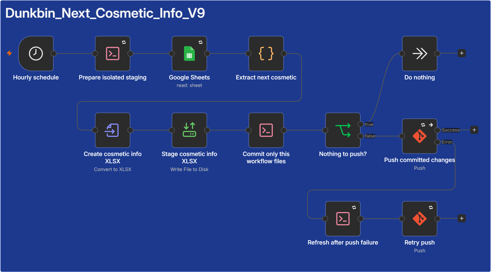
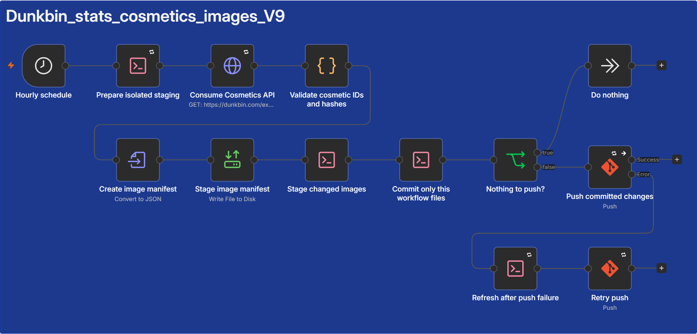
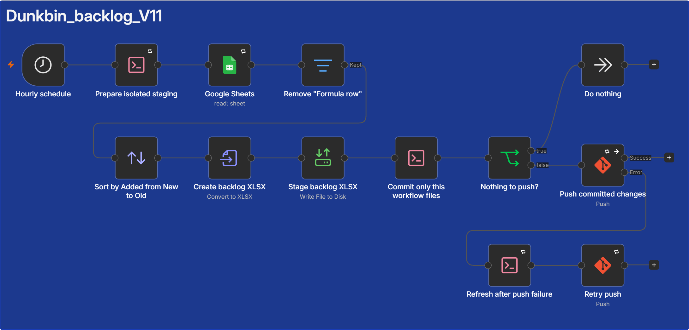
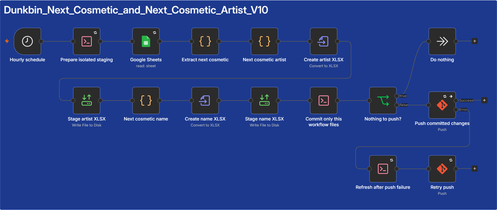
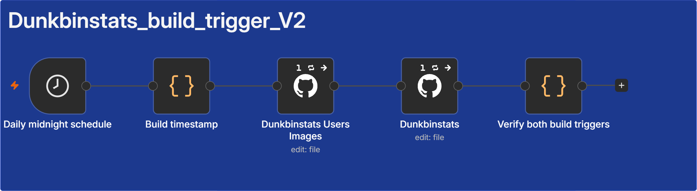
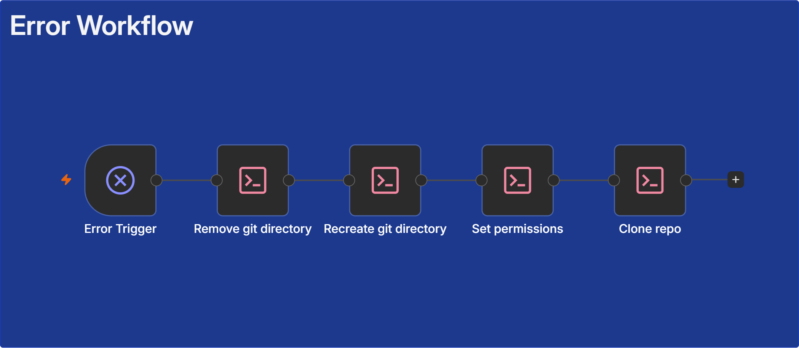
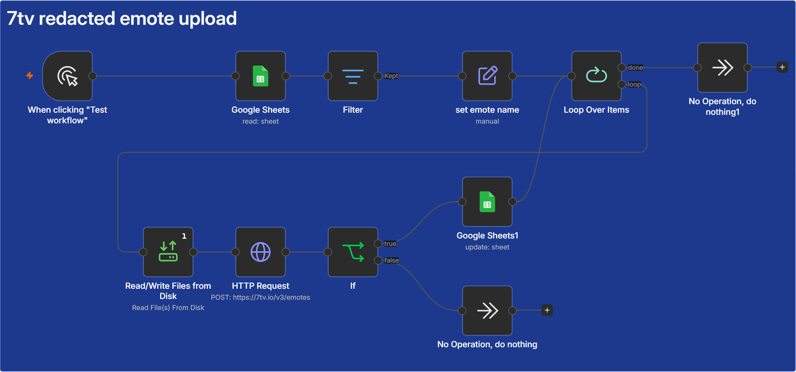
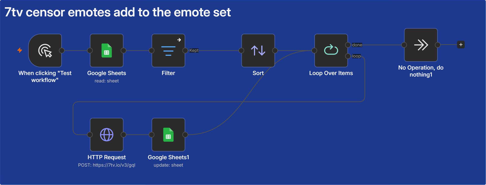
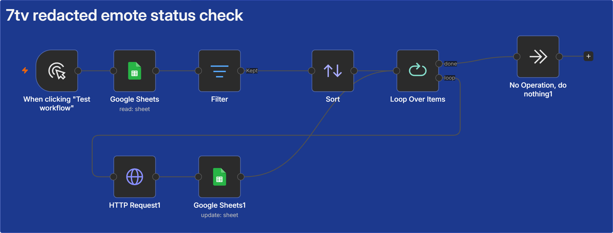

# dunkbin-stats-images

## Repo for dunkbin fantasy shop cosmetics and analytical dashboard.

### Next cosmetic info workflow V9

Reads one Google Sheets snapshot for the cosmetic name, artist, and row number, then generates the existing XLSX format.

### Cosmetic images workflow V9

Checks local hashes in one batch, downloads changed images with bounded concurrency and retries, and verifies each PNG and MD5 before publication. New and modified tracked images are committed together.

### Backlog spritesheet workflow V11

Reads Google Sheets once, sorts with the current Sort node, and generates one XLSX with Convert to File. The publication step compares the staged file with the existing file and skips unchanged commits.

### Next cosmetic and artist workflow V10

Reads one Sheets snapshot and publishes the artist and cosmetic-name workbooks in its own commit.

### Dunkbinstats build trigger V2

Runs at midnight in Asia/Bishkek. Both repositories receive the same timestamp; the second trigger is attempted even if the first fails, and any remaining failure is reported.

### Error workflow V4

Checks the checkout and creates missing output directories. A missing or empty checkout can be cloned; a nonempty invalid checkout, local edits, and unfinished Git operations are preserved for manual review.

### Shared publication behavior

Each producer writes to an ignored `n8n-staging/<workflow-id>/<execution-id>/` directory. A shared `flock` serializes checkout preparation, fetch/rebase, file installation, and commits. Each commit includes only that workflow's output files. Git push uses the existing n8n credential; a failed push triggers a locked refresh/rebase and another push attempt. Unchanged runs also detect commits left pending by an earlier failed push.

Successful runs remove their staging directory. Failed staging files remain ignored for inspection. Conflicting incoming commits or unrelated staged changes stop publication without discarding local work.

Hourly schedules remain at minutes 05 (backlog), 23 (images), 33 (artist/name), and 50 (info). Current exports are in `n8n_workflows/`; previous exports are retained in `n8n_workflows/archive/`. Each workflow export includes all its code.

### Archived workflows

The three 7TV workflows remain inactive, with their exports in `n8n_workflows/archive/`.

#### 7tv emotes upload workflow

### Gotchas

Running n8n inside a container requires

1. The container's `node` user needs write access to `/home/node/git/` and its checkout.
2. Setting DNS server in case you run it alongside Adguard Home or similar, otherwise n8n will not be able to access external services.
3. Keep the Git, GitHub, Google Sheets, and Dunkbin API credentials configured in n8n. Workflow exports contain credential references.
4. Allow file-node access to `/home/node/git/dunkbin-stats-images/` using `N8N_RESTRICT_FILE_ACCESS_TO`. The container must provide Node.js, Git, and `flock`.
